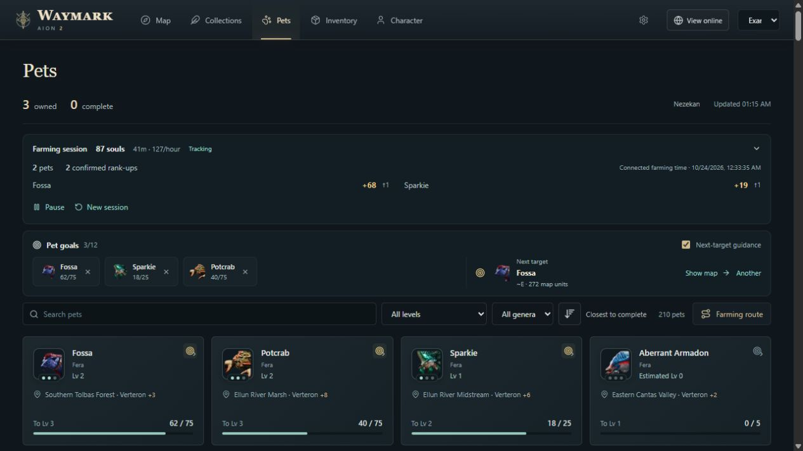
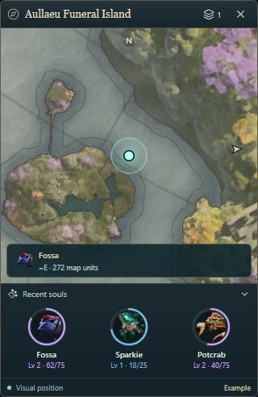
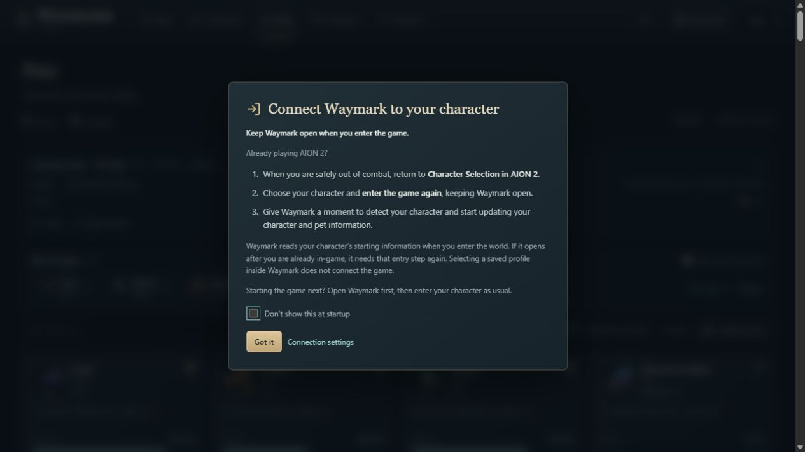

# Waymark for AION 2

**Maps, farming routes and pet progress for AION 2.**

Waymark is a Windows app for AION 2 Global Steam. Explore the world map, build farming routes, and follow your pet collection in one place. A floating minimap keeps nearby objectives visible while you play.

[**Download Waymark 0.5.17 for Windows**](https://github.com/ErebusAres/waymark-downloads/releases/download/v0.5.17/Waymark-0.5.17-Setup.exe) · [Getting started](docs/GETTING_STARTED.md) · [Release notes](https://github.com/ErebusAres/waymark-downloads/releases/tag/v0.5.17) · [Screenshot gallery](docs/SCREENSHOTS.md) · [All downloads](https://github.com/ErebusAres/waymark-downloads/releases)

[**Visit the Waymark website**](https://waymark-aion2.erebusares.chatgpt.site) · [Help & FAQ](https://waymark-aion2.erebusares.chatgpt.site/help)

Windows 10/11, 64-bit. Public preview. No GitHub account needed to download.

## Explore with a purpose

- **World maps with terrain.** Find feathers, gathering nodes, kibelisks, sealed dungeons and strongholds. Verteron and Altgard use English kibelisk names; Abyss reference maps are also included.
- **Recognize nearby creatures.** Readable farming-pocket icons replace repeated tiny portraits. Overlapping pockets share a numbered badge; click it for creature names, icons and ranks. The badge counts creatures, not spawns. Pet-level colors remain on the portrait.
- **Choose what appears.** Toggle whole categories, resource groups or individual resources. Show every enabled marker when zoomed out, or turn on grouping.
- **Keep your own routes.** Name custom pins, choose a route start and save a circuit. Filters, follow mode, routes and map views are remembered.
- **A minimap that fits your setup.** Move it, cycle three zoom levels, or scroll to zoom while unlocked. It stays above other windows and can lock with click-through enabled.
- **Readable at your size.** Set separate main-app and minimap text sizes in Settings → Appearance. Increase either from 100% to 200%, with automatic saving and individual resets. Navigation, cards and toolbars adapt around larger text.
- **Choose your own colors.** Personalize the player marker and glow, pet ranks and map accents in Settings → Appearance. Reset one color or restore the original palette.
- **Track collection progress.** Mark individual objectives or declare a whole category complete for a character. Progress can be reset in Settings.

Hover or select a creature to reveal its reference dots and subtle area tint. Other creatures remain visible. Zooming in separates nearby pocket badges. The main map and minimap use the same display rules.

## See your next pet upgrade

Pet cards bring together portraits, names, farming locations, levels and soul progress. Closest to complete is the default order, with completed level 3 pets at the bottom. Switch to alphabetical, least progress first, or recent pickups.

Missing starting levels use clearly labeled estimates from zero. Pickups advance those estimates at 5, 25 and 75 souls; confirmed game readings replace them. Estimated maximum ranks remain visible for farming. Supported live soul pickups update progress without relogging, and reaching a tier threshold advances the displayed level. If a level is missing or appears stale, open that pet’s in-game card with the game focused for a few seconds. Waymark checks the selected tile against the card and updates the saved rank and count automatically. Card verification currently supports the English pet screen and uses Windows’ built-in OCR. Pet progress is shared between characters on the same server. Farming locations use reference monster spawn points where available, with regional fallbacks labeled separately. The location button beside pet sorting cycles **All locations → Verteron only → Altgard only → Abyss only**, filtering the library and displayed sources. Your choice is saved independently of sorting.

*Screenshots use an example profile and illustrative progress.*

Use **All sources**, **World farming**, or **Boxes & rewards only** to narrow the pet library. Rewards-only means the catalog records a chest or reward and no world drop or farming area; it does not guarantee that another source cannot exist.

For a farming circuit, select pets on their cards, open **Farming route**, choose the map and **Completion priority** or **Nearby first**, then **Save and use route**. Routes use that selection independently of the card filters. The map fits all stops, with gold numbered markers and connecting lines; reorder them in **Circuit**.

[See the new pocket badges, creature chooser, minimap tiers and route examples](docs/SCREENSHOTS.md#pet-location-display-in-0515).

## A cleaner desktop workspace

The 0.4.0 remaster puts navigation in one compact header and gives terrain the full map workspace. Floating Layers and Locations panels keep filters and search within reach. Pet cards stay the same size; farming details open separately. Settings groups everyday preferences, appearance, updates, backups, statistics and connection tools into clear sections. Hover or focus a control for an explanation when you need one.

In 0.4.1, the minimap title shows the detected region, retains a recent last-known region for up to 30 seconds, then reads **Unavailable**. Long names truncate with an ellipsis; hover to see the full name. All three zoom tiers are closer, with your saved tier choice preserved. A foldable **Recent souls** strip shows the latest three pets with portrait progress rings, rank colors and a brief completion effect before confirmed max-level pets leave the strip. Your fold preference is saved. Click a pet in the unlocked strip to bring Waymark forward and open its details, then use its map buttons to view farming areas for that creature.

The Windows minimap keeps its **padlock button beside the zoom control**. Lock it for click-through; press **Ctrl+Shift+G** to unlock. Its position, zoom and lock state are saved. The image above shows the Windows lock control and recent-souls tracker.

[See current pet-location examples and the complete interface gallery](docs/SCREENSHOTS.md), including collections, inventory, character resources, pet farming details and every Settings section.

## Farm toward your next upgrade

Open the **Farming session** foldout on Pets for observed souls, connected farming time, souls/hour after the first minute, per-pet gains and confirmed rank-ups. Sessions start with the next accepted pickup, pause their clock when the reader disconnects, and save locally for each character. Pause/resume the summary or select **New session** for fresh counters; pausing the summary does not stop collection progress.

Auto suggests farming pockets using needed-pet overlap, mapped target density and a travel-distance penalty, outside the pets you are actively farming. Recent current-session soul pickups identify that group. Completed Lv.3 pets are excluded, and manually chosen unfinished targets stay selected. With unfinished goals, it chooses from that shortlist. Click a goal name, **Use as target** in pet details, or **Another** to make an explicit choice; **Auto** returns to reference-based spot suggestions. A small gold star marks the current suggested pocket; its summary explains the target spawn count and any overlap with other needed pets. Chosen targets save separately from automatic suggestions.

Add up to 12 **pet goals** with the target icon on a pet card. Goals are shared by server. The next-target suggestion favors unfinished goals and nearby mapped pockets, advances when the current target reaches maximum progress, and can be changed with **Another** or disabled using **Next-target guidance**.

The minimap shows a target cue inside the map or an edge arrow when it is out of view. Targets in another territory show **Travel to Altgard**, Verteron or Abyss. Distance uses the map's available units; directions disappear when the position is stale. These are approximate straight-line references, not walkable routes or live spawn detections.

## Find a farming pocket

Version 0.5.1 adds 1,124 reference positions from [Aion Dex](https://aion2dex.com/farming/) for Verteron and Altgard, compared by numeric NPC ID against the existing Questlog data. Pet markers now represent compact spawn groups, including separate pockets within the same region. Select one to see its footprint and mapped spawn count. Select a creature to see its individual reference dots. Nearby same-pet references share counts and separate as you zoom closer. **Display → Always show spawns** shows all enabled creature references at every zoom; your choice is saved. This applies to the main map and minimap. These are reference-based density suggestions, not measured souls/hour or live monster availability.

These are static reference locations. A dense pocket can help you choose where to look, but does not establish the fastest farm or show live monster availability.

## Start playing

1. Download and run **Waymark-0.5.17-Setup.exe**. Setup includes the WebView2 bootstrapper if the Windows web runtime is missing.
2. Choose a starting map and whether to open the floating minimap. You can change both later.
3. For automatic character and pet reads, install [Npcap from its official site](https://npcap.com/#download) with **WinPcap API-compatible Mode** enabled. Map planning works without it.
4. Start Waymark before entering your character. If you opened Waymark while already in game, return to character selection and enter once so it can identify the session.
5. Open the in-game map briefly to acquire a visual position, then choose your layers and route.

See the [getting-started guide](docs/GETTING_STARTED.md) for controls, update settings, troubleshooting and backups.

## Connecting your character

**Keep Waymark open when you enter the game.** Already playing AION 2? When safely out of combat, return to **Character Selection in AION 2**, choose your character and enter again while Waymark stays open. Give it a moment to detect your character and start updating information.

Waymark reads the starting character information during world entry. Selecting a saved profile inside Waymark does not connect the game. If starting the game next, open Waymark first and enter your character normally.

Waymark explains this at startup when a character has not connected. **Don't show this at startup** remembers your preference; restore it under **Settings → Connection**. The notice stays dismissed for the current launch and does not reopen after a later disconnection.

## Current coverage

Waymark is under active development. Visual position tracking is verified in Verteron and Altgard. Abyss tracking and cross-faction transitions still need live validation. Position comes from visible game terrain; a last-known marker remains visible when a fresh fix is unavailable.

Resource and pet spawn markers are reference locations, not a live spawn-availability feed. Routes connect map objectives; they do not calculate a walkable path around terrain. Supported Empyrean Traces update directly from character-bound achievement messages, with previously collected traces restored during a fresh character entry. The game map is not required for those updates. Checked Verteron map icons remain a fallback. Ambiguous or missing location-catalog matches are excluded. Dungeon and stronghold completion, including reset-period rewards, is not yet fully detected automatically; use manual collection controls where needed. Inventory and other character information depend on the fields the reader can currently observe.

## Compare farming sessions

Expand **Farming session** on the Pets page to add an optional label, pause/resume counting, or start a new session. Waymark keeps the last **20 completed sessions per character**, including observed souls, connected time and rates, so you can compare runs. History stays local and is included in full backups. Location details distinguish **Mapped reference** from **General area**; reference density does not establish a player-verified farming rate.

## Usage statistics

Settings → Statistics shows characters seen, app and connected time, observed souls, pets leveled, rank-ups, pets maxed and app launches. Counters save automatically from this version onward. Copy a counts-only summary or export cumulative reporting JSON for future combined totals. A reporting service is not connected yet; statistics currently stay local. [How the counters work](docs/USAGE_STATISTICS.md).

## Updates and local data

Version 0.5.2 reduces minimap geometry traffic, caches marker grouping and skips drawing offscreen markers. The background reader runs at below-normal scheduling priority, and visual terrain scans pause longer when matching is expensive. Packet-based soul tracking runs independently.

Waymark checks for updates on launch by default. Download and automatic installation preferences are available in **Settings → Updates**. From 0.4.2, automatic download and installation preferences apply both on launch and when you select **Check for updates**. Downloads show progress; installing an update restarts the app. The built-in updater verifies release signatures before installation.

Character observations, progress, pins, routes and settings are stored locally. Waymark does not ask for your game password, control your character or inject code into the game. Research recordings are explicit local captures, not automatic uploads. Use **Settings → Data & backups** before moving or resetting data.

## Help and feedback

[Report a problem or request a feature](https://github.com/ErebusAres/waymark-downloads/issues). Include the Waymark version, map, steps to reproduce and a screenshot if useful. Settings → Connection can review/copy or save a diagnostic report with status codes and counts, excluding names, IDs, locations, paths and packet data. See [detection coverage](docs/DETECTION_COVERAGE.md). Keep login details and packet captures out of public issues.

This repository contains public downloads and documentation. Application source is maintained separately. Waymark is an independent project and is not affiliated with NCSOFT. AION 2 names and game artwork belong to their respective owners; bundled attribution accompanies the app.

## Downloads and help

The [Waymark website](https://waymark-aion2.erebusares.chatgpt.site) provides downloads, install instructions and help. Online character pages, player search, cloud saves and remote usage reporting have retired. No account link is needed.

Pet tracking, collection progress, settings, routes, pins, minimap layout and usage statistics stay on your PC. Use **Settings → Data & backups** for local backups. The old tracking endpoints stop accepting uploads, including from older versions.
