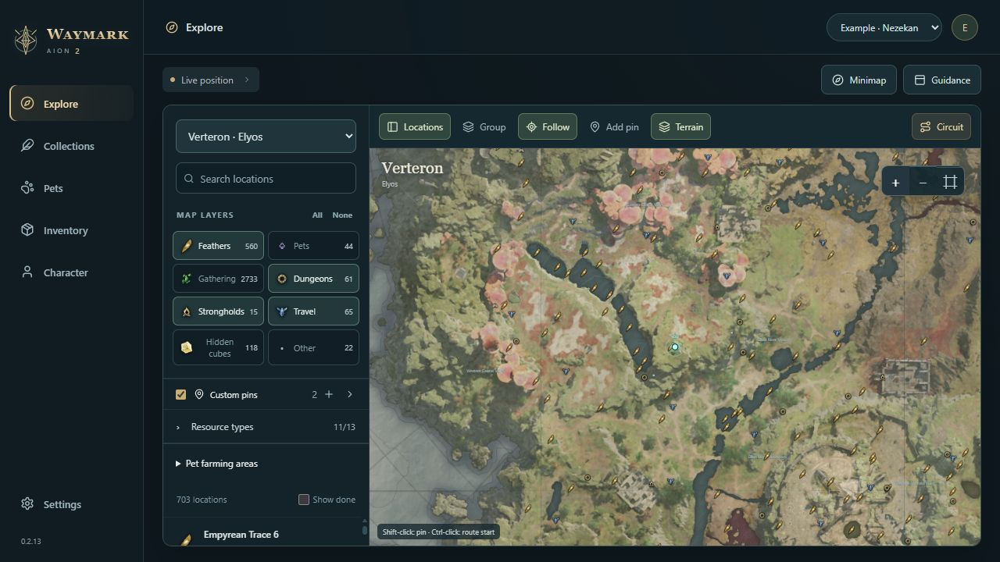
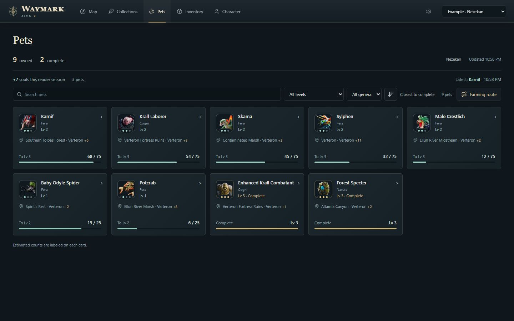
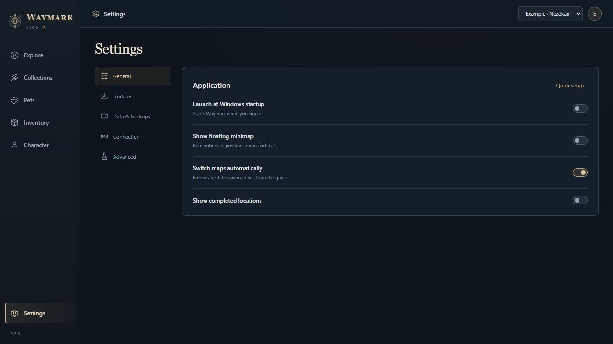
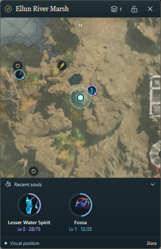
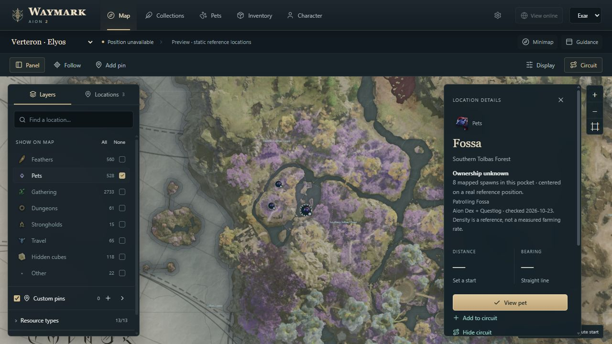

# Waymark for AION 2

**Maps, farming routes and pet progress for AION 2.**

Waymark is a Windows app for AION 2 Global Steam. Explore the world map, build farming routes, and follow your pet collection in one place. A floating minimap keeps nearby objectives visible while you play.

[**Download Waymark 0.5.1 for Windows**](https://github.com/ErebusAres/waymark-downloads/releases/download/v0.5.1/Waymark-0.5.1-Setup.exe) · [Getting started](docs/GETTING_STARTED.md) · [Release notes](https://github.com/ErebusAres/waymark-downloads/releases/tag/v0.5.1) · [Screenshot gallery](docs/SCREENSHOTS.md) · [All downloads](https://github.com/ErebusAres/waymark-downloads/releases)

[**Visit the Waymark website**](https://waymark-aion2.erebusares.chatgpt.site) · [Find a player](https://waymark-aion2.erebusares.chatgpt.site/players) · [Help & FAQ](https://waymark-aion2.erebusares.chatgpt.site/help)

Windows 10/11, 64-bit. Public preview. No GitHub account needed to download.

## Explore with a purpose

- **World maps with terrain.** Find feathers, gathering nodes, kibelisks, sealed dungeons and strongholds. Verteron and Altgard use English kibelisk names; Abyss reference maps are also included.
- **Choose what appears.** Toggle whole categories, resource groups or individual resources. Show every enabled marker when zoomed out, or turn on grouping.
- **Keep your own routes.** Name custom pins, choose a route start and save a circuit. Filters, follow mode, routes and map views are remembered.
- **A minimap that fits your setup.** Move it, cycle three zoom levels, or scroll to zoom while unlocked. It stays above other windows and can lock with click-through enabled.
- **Choose your own colors.** Personalize the player marker and glow, pet ranks and map accents in Settings → Appearance. Reset one color or restore the original palette.
- **Track collection progress.** Mark individual objectives or declare a whole category complete for a character. Progress can be reset in Settings.

## See your next pet upgrade

Pet cards bring together portraits, names, farming locations, levels and soul progress. Closest to complete is the default order, with completed level 3 pets at the bottom. Switch to alphabetical, least progress first, or recent pickups.

Missing starting levels use clearly labeled estimates from zero. Pickups advance those estimates at 5, 25 and 75 souls; confirmed game readings replace them. Estimated maximum ranks remain visible for farming. Supported live soul pickups update progress without relogging, and reaching a tier threshold advances the displayed level. If a level is missing or appears stale, open that pet’s in-game card with the game focused for a few seconds. Waymark checks the selected tile against the card and updates the saved rank and count automatically. Card verification currently supports the English pet screen and uses Windows’ built-in OCR. Pet progress is shared between characters on the same server. Farming locations use reference monster spawn points where available, with regional fallbacks labeled separately.

*Screenshots use an example profile and illustrative progress.*

## A cleaner desktop workspace

The 0.4.0 remaster puts navigation in one compact header and gives terrain the full map workspace. Floating Layers and Locations panels keep filters and search within reach. Pet cards stay the same size; farming details open separately. Settings groups everyday preferences, appearance, updates, backups, statistics and connection tools into clear sections. Hover or focus a control for an explanation when you need one.

In 0.4.1, the minimap title shows the detected region, retains a recent last-known region for up to 30 seconds, then reads **Unavailable**. Long names truncate with an ellipsis; hover to see the full name. All three zoom tiers are closer, with your saved tier choice preserved. A foldable **Recent souls** strip shows the latest three pets with portrait progress rings, rank colors and a brief completion effect before confirmed max-level pets leave the strip. Your fold preference is saved.

The Windows minimap keeps its **padlock button beside the zoom control**. Lock it for click-through; press **Ctrl+Shift+G** to unlock. Its position, zoom and lock state are saved. The image above shows the Windows lock control and recent-souls tracker.

[See every page and feature example in the 0.4.0 screenshot gallery](docs/SCREENSHOTS.md), including collections, inventory, character resources, pet farming details and every Settings section.

## Find a farming pocket

Version 0.5.1 adds 1,124 reference positions from [Aion Dex](https://aion2dex.com/farming/) for Verteron and Altgard, compared by numeric NPC ID against the existing Questlog data. Pet markers now represent compact spawn groups, including separate pockets within the same region. Select one to see its footprint and mapped spawn count. **Display → Spawn dots** restores individual references; your choice is saved.

These are static reference locations. A dense pocket can help you choose where to look, but does not establish the fastest farm or show live monster availability.

## Start playing

1. Download and run **Waymark-0.5.1-Setup.exe**. Setup includes the WebView2 bootstrapper if the Windows web runtime is missing.
2. Choose a starting map and whether to open the floating minimap. You can change both later.
3. For automatic character and pet reads, install [Npcap from its official site](https://npcap.com/#download) with **WinPcap API-compatible Mode** enabled. Map planning works without it.
4. Start Waymark before entering your character. If you opened Waymark while already in game, return to character selection and enter once so it can identify the session.
5. Open the in-game map briefly to acquire a visual position, then choose your layers and route.

See the [getting-started guide](docs/GETTING_STARTED.md) for controls, update settings, troubleshooting and backups.

## Current coverage

Waymark is under active development. Visual position tracking is verified in Verteron and Altgard. Abyss tracking and cross-faction transitions still need live validation. Position comes from visible game terrain; a last-known marker remains visible when a fresh fix is unavailable.

Resource and pet spawn markers are reference locations, not a live spawn-availability feed. Routes connect map objectives; they do not calculate a walkable path around terrain. Automatic claimed-feather recognition is limited to supported Verteron map views. Dungeon and stronghold completion, including reset-period rewards, is not yet fully detected automatically; use manual collection controls where needed. Inventory and other character information depend on the fields the reader can currently observe.

## Usage statistics

Settings → Statistics shows characters seen, app and connected time, observed souls, pets leveled, rank-ups, pets maxed and app launches. Counters save automatically from this version onward. Copy a counts-only summary or export cumulative reporting JSON for future combined totals. A reporting service is not connected yet; statistics currently stay local. [How the counters work](docs/USAGE_STATISTICS.md).

## Updates and local data

Waymark checks for updates on launch by default. Download and automatic installation preferences are available in **Settings → Updates**. From 0.4.2, automatic download and installation preferences apply both on launch and when you select **Check for updates**. Downloads show progress; installing an update restarts the app. The built-in updater verifies release signatures before installation.

Character observations, progress, pins, routes and settings are stored locally. Waymark does not ask for your game password, control your character or inject code into the game. Research recordings are explicit local captures, not automatic uploads. Use **Settings → Data & backups** before moving or resetting data.

## Help and feedback

[Report a problem or request a feature](https://github.com/ErebusAres/waymark-downloads/issues). Include the Waymark version, map, steps to reproduce and a screenshot if useful. Settings → Connection can review/copy or save a diagnostic report with status codes and counts, excluding names, IDs, locations, paths and packet data. See [detection coverage](docs/DETECTION_COVERAGE.md). Keep login details and packet captures out of public issues.

This repository contains public downloads and documentation. Application source is maintained separately. Waymark is an independent project and is not affiliated with NCSOFT. AION 2 names and game artwork belong to their respective owners; bundled attribution accompanies the app.

## Your character, online

Waymark 0.5.0 adds a public website with player search, character collections, downloads and installation guides. Select **View online** beside the active character, or **Settings → Website & sync → Connect account**. Sign in and approve the installation code once. No game password is requested.

Connected installations attempt sync every 30 seconds. Public pages show character name, region, server, faction, pet observations and marked collection totals. Search accepts **Jilara[NEZ]**, a name and separate server filter, or a name prefix. Searching a name alone includes matches across servers, labeled Jilara[NEZ], Jilara[ZIK], and so on. The directory includes only synced visible Waymark profiles. Upload time and game observation time are shown separately; a recent sync does not prove a character is online.

Settings, routes, custom pins and window layouts are saved privately to the account. The site keeps five changed saves per device, downloadable as JSON. Automatic restore is not included. Exact live positions, inventory, captures and credentials are not uploaded. Manage profile visibility and connected devices in **My characters**. Usage totals are cumulative and do not count the same installation report repeatedly.

These are app-synced observations, not official game records or independent ownership verification. [Read the data policy](https://waymark-aion2.erebusares.chatgpt.site/privacy).

[View website screenshots and setup overview](docs/WEBSITE.md).
