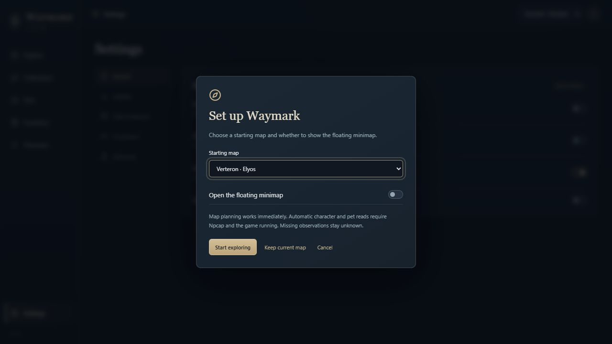
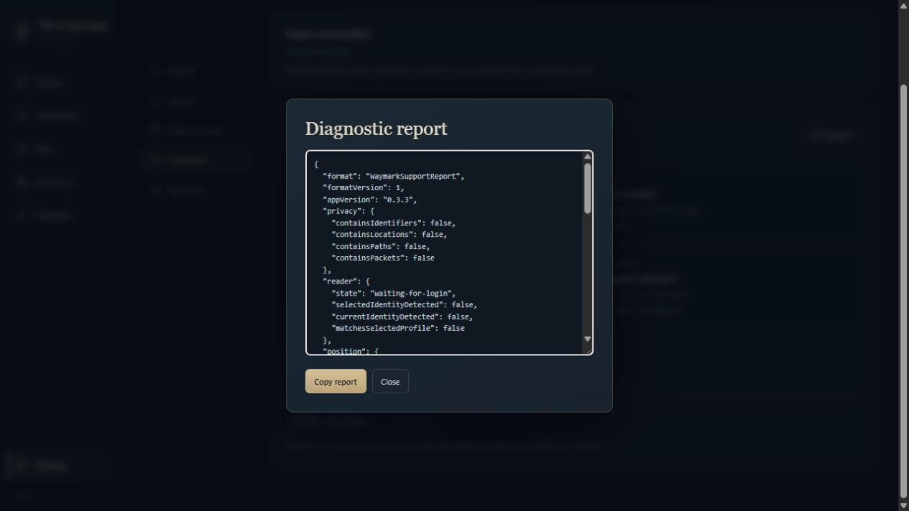

# Getting started with Waymark

[Download 0.3.7](https://github.com/ErebusAres/waymark-downloads/releases/download/v0.3.7/Waymark-0.3.7-Setup.exe) · [Back to Waymark](../README.md)

## Install

Run **Waymark-0.3.7-Setup.exe** on 64-bit Windows 10 or 11. The installer includes a WebView2 bootstrapper for systems missing that runtime; it may need an internet connection. No Python, Node.js or development tools are required.

On first launch, select Verteron, Altgard or Abyss and choose whether to show the floating minimap. **Start exploring** applies the map selection; **Keep current map** keeps the existing map. Both actions save the minimap checkbox.

The preview installer does not currently have a Windows publisher certificate. The built-in updater separately verifies Waymark release signatures; this is different from Windows publisher signing. Download only from this repository's Releases page.

## Enable automatic reads

Map browsing, filters, pins and manual progress work without a game connection. For automatic character identification and pet reads:

1. Install [Npcap](https://npcap.com/#download) from its official site. Enable **Install Npcap in WinPcap API-compatible Mode**; see the [official installation guide](https://npcap.com/guide/npcap-users-guide.html).
2. Run only one AION 2 Global Steam client. Waymark's passive reader can run alongside NotMeter. Keep A2Tools and AetherTrail closed. Independent Npcap handles were checked with local test traffic; simultaneous gameplay with NotMeter still needs confirmation.
3. Start Waymark, then enter your character. If the character was already logged in when Waymark started, return to character selection and enter once.
4. Check the character selector. Waymark switches profiles when it identifies another character; pets are shared by server, while collection progress belongs to the selected character.

Explicit research recording still requires closing NotMeter and the other readers. Passive character/pet reading does not save raw packets.

Missing observations remain unknown. Selecting a planning profile manually does not identify a game session or create a pet baseline.

## Map and route controls

| Control | Action |
| --- | --- |
| Mouse wheel / + / − | Zoom the map |
| Drag | Pan; stops Follow |
| Follow | Center and zoom around your position |
| Zoom out beyond 35% of map width | Stop Follow; keep displaying your location |
| Shift-click | Add a custom pin and give it a name |
| Ctrl-click | Set the route start |
| Circuit | Build a circuit from the enabled, unfinished objectives |
| Group | Combine nearby markers when zoomed out; off by default |
| Map layers | Show or hide categories, custom pins and individual resource types |

Open the in-game world map briefly to help the visual reader acquire your position. Verified terrain matching covers Verteron and Altgard; Abyss and cross-faction transitions need further live validation. A glowing teal dot indicates a live fix. The larger amber marker is the last-known location, not a current reading. Direction is not inferred from that dot.

Routes are map guidance between reference points, not terrain-aware navigation. Marker placement does not prove that a monster or resource is currently available.

## Floating minimap

Use **Minimap** on Explore or **Settings → General → Show floating minimap**. Turning the setting off closes the minimap immediately and remembers the choice for the next launch.

The minimap starts near the player at the closest zoom tier. Drag its header to move it. Use the tier button to cycle three zoom levels, or the scroll wheel while unlocked. Lock enables click-through so clicks reach the game beneath it. **Ctrl+Shift+G** unlocks the overlay. If another app owns that shortcut, Waymark keeps click-through off.

The default position is 45 pixels from the primary monitor's top-left corner. Position, zoom and lock are remembered. The minimap stays on top and follows the same enabled objective layers as the main map.

## Pets and soul progress

The Pets page shows portraits, farming references and the latest observed level and points. The tier costs are **5**, **25** and **75** souls. The bar shows progress within the current tier. Supported pickups advance that count and level; fresh login observations resynchronize the baseline.

Closest to complete puts the highest unfinished tier first, then the most points within that tier. Completed level 3 pets remain at the bottom. Use the sort icon to cycle through closest, least progress, alphabetical and recent pickups. Search and filters are saved.

The farming summary shows souls observed in the current reader session, the number of affected pets and the latest pickup. Expanded cards keep previous-session gains labeled separately. These totals cover observed pickups, not a full play-session history or souls earned while the reader was disconnected.

A soul gain without a known baseline cannot establish a reliable total. Check the reader status if cards show unknown progress or wait for a fresh character login. Pet progress is shared between characters on the same server, not across different servers. Spawn dots are farming references; regional fallbacks are less precise and labeled as such.

## Claimed and completed objectives

Use Collections or an objective's details to mark progress manually. Bulk controls let you declare a category complete for the current character. Settings includes reset controls for that character; read the reset dialog to choose whether to clear manual marks alone or the wider recorded progress.

Supported Verteron map views can recognize claimed-feather evidence. Automatic completion coverage is incomplete: do not assume sealed dungeon or stronghold first-clears and current reset-period rewards have all been read. Use manual controls for missing information. Unknown and unobserved states are not proof of completion.

## Saved preferences

Map layers, individual resource filters, Follow, per-map pan and zoom, custom pins, circuits, named routes, pet sorting, collection filters, inventory filters and the selected Settings section are saved locally. The minimap remembers whether it is open, its X/Y position, zoom tier and lock. Main-window position, size and maximized state are also retained. If a monitor is disconnected, an off-screen window returns to the primary display.

Update preferences are saved in Settings. **Launch at startup** controls the current Windows user's startup entry.

## Updates

**Check on launch** is enabled by default. In **Settings → Updates**, choose whether Waymark should download or install automatically. Manual installation is also available after a verified download. The app displays download progress and an installing message, then restarts when complete.

GitHub releases are the public update source. Local build support remains available in Settings. Automatic updates preserve the workspace and create recovery backups. A full backup is still useful before moving machines or making a large reset. If preparation or installer startup fails, the verified download remains available for retry until the app closes and normal worker operation resumes. A restarted reader may need fresh character login evidence. If Windows installation itself was interrupted, rerun a working Setup build and use Data & backups to review a recovery archive if needed; automatic rollback after installation begins is not implemented.

## Diagnostic reports

In **Settings → Connection**, use **Review / copy report** to inspect and copy the diagnostic JSON, or **Save report…** to choose a local file. It contains status codes and counts only; character/server/session IDs, names, maps, coordinates, paths, IP addresses, raw errors and packets are excluded. Nothing is uploaded automatically. The detailed local reader panel remains separate from this report. See [current detection coverage](DETECTION_COVERAGE.md).

## Backups and troubleshooting

Data is stored in **%LOCALAPPDATA%\AionCompanion** unless a custom data directory was configured. Use the full backup and restore controls in Settings to keep the database and related settings together.

| Symptom | Check |
| --- | --- |
| No character or pet updates | Npcap compatibility option, one supported game client, other readers closed, then enter a character after starting Waymark |
| Position unavailable | Correct map, visible in-game map/minimap terrain, reader diagnostics; last-known is not a fresh fix |
| Minimap appears unexpectedly | Update to 0.3.7, turn off **Show floating minimap**, then relaunch to confirm the saved preference |
| Teleport names are not English | Update to 0.3.7; all Verteron and Altgard kibelisk labels were replaced |
| App cannot check online updates | Check the selected update source and connection; the current installer is always on the Releases page |

For a report, include the app version, map, steps and relevant status text. Crop private information from screenshots. Do not attach game login details, databases or packet captures to a public issue.

## Custom colors

Open **Settings → Appearance** to change player markers and glow, last known position, pet ranks and map accents. Choose a color or enter a six-digit hex value. Colors save automatically and apply to the map, minimap and pet cards. Use the reset beside a color to restore its original appearance, or **Reset all colors** to restore the full original palette. Other settings and progress are preserved.

## Verify a pet’s current level

If a pet stays unknown or its level looks stale, open its card in the game and leave the game focused for a few seconds. Waymark checks the selected tile and Pet Insight panel before updating its level and soul count. This currently supports the English pet screen and Windows’ built-in OCR. The game session must already be identified; unopened cards are not scanned.

## Estimated pet progress

Pets with missing starting levels show an estimated count from zero. Observed pickups advance at 5 souls for Lv.1, another 25 for Lv.2, and another 75 for Lv.3. Estimates are labeled and replaced by confirmed game readings. An estimated Lv.3 does not count as confirmed completion or hide its map marker.

## If the automatic reader stops updating

Update to 0.3.7 for bounded packet reassembly, automatic stalled-worker replacement and canonical access to moved data folders. A restarted reader needs a fresh character entry to identify the session; when safe, return to character selection and enter once. Saved progress remains available while waiting. Pickups missed during a capture gap are not invented; supported login readings resync the available counts.
