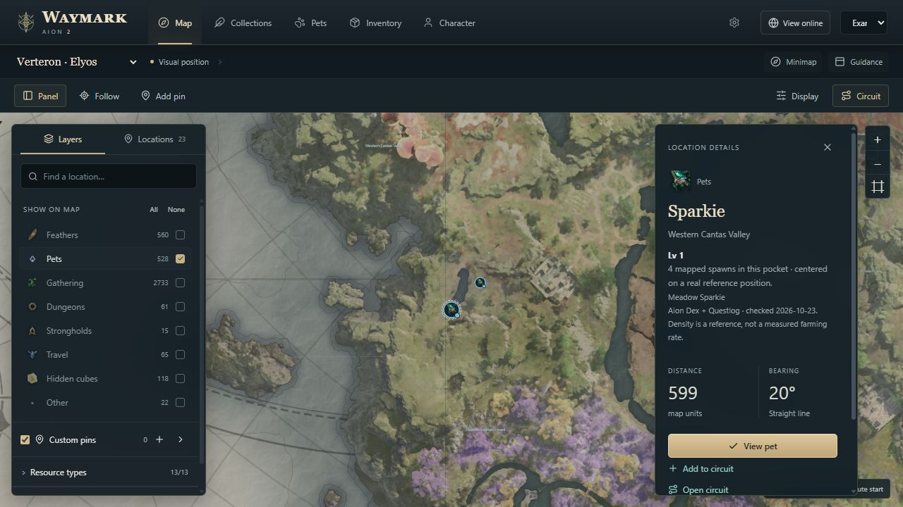
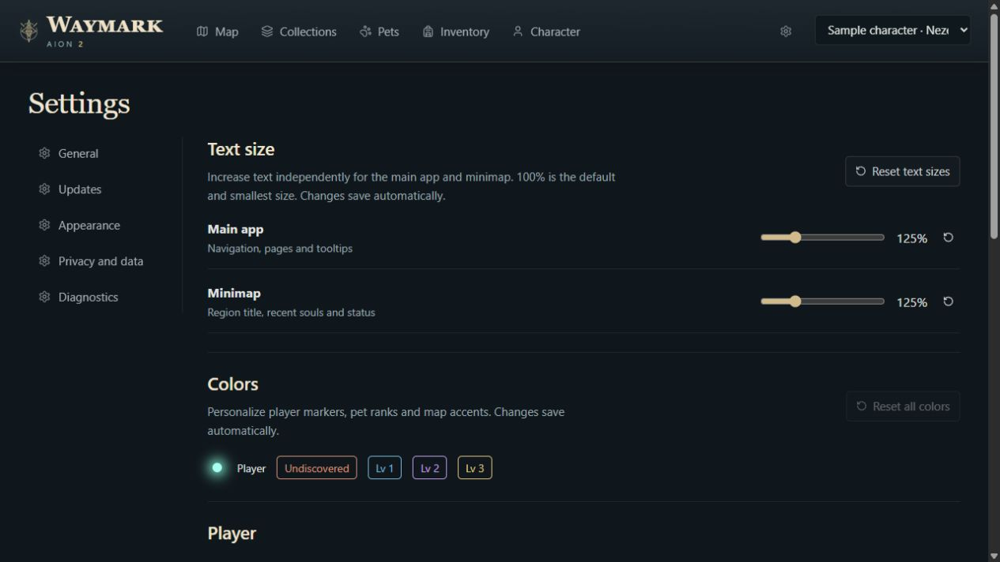

# Getting started with Waymark

[Download 0.5.11](https://github.com/ErebusAres/waymark-downloads/releases/download/v0.5.11/Waymark-0.5.11-Setup.exe) · [Back to Waymark](../README.md)

## Install

Run **Waymark-0.5.11-Setup.exe** on 64-bit Windows 10 or 11. The installer includes a WebView2 bootstrapper for systems missing that runtime; it may need an internet connection. No Python, Node.js or development tools are required.

On first launch, select Verteron, Altgard or Abyss and choose whether to show the floating minimap. **Start exploring** applies the map selection; **Keep current map** keeps the existing map. Both actions save the minimap checkbox.

The preview installer does not currently have a Windows publisher certificate. The built-in updater separately verifies Waymark release signatures; this is different from Windows publisher signing. Download only from this repository's Releases page.

## Enable automatic reads

Map browsing, filters, pins and manual progress work without a game connection. For automatic character identification and pet reads:

1. Install [Npcap](https://npcap.com/#download) from its official site. Enable **Install Npcap in WinPcap API-compatible Mode**; see the [official installation guide](https://npcap.com/guide/npcap-users-guide.html).
2. Run only one AION 2 Global Steam client. Waymark's passive reader can run alongside NotMeter. Keep A2Tools and AetherTrail closed. Independent Npcap handles were checked with local test traffic; simultaneous gameplay with NotMeter still needs confirmation.
3. Start Waymark, then enter your character. If the character was already logged in when Waymark started, return to character selection and enter once.
4. Check the character selector. Waymark switches profiles when it identifies another character; pets are shared by server, while collection progress belongs to the selected character.

Explicit research recording still requires closing NotMeter and the other readers. Passive character/pet reading does not save raw packets.

Missing observations remain unknown. Selecting a planning profile manually does not identify a game session or create a pet baseline.

## Map and route controls

| Control | Action |
| --- | --- |
| Mouse wheel / + / − | Zoom the map |
| Drag | Pan; stops Follow |
| Follow | Center and zoom around your position |
| Zoom out beyond 35% of map width | Stop Follow; keep displaying your location |
| Shift-click | Add a custom pin and give it a name |
| Ctrl-click | Set the route start |
| Circuit | Build a circuit from the enabled, unfinished objectives |
| Display → Always show spawns | Points appear automatically up close; enable this override to keep them visible at wider zoom |
| Display → Group | Combine nearby markers when zoomed out; off by default |
| Layers panel | Show or hide categories, custom pins and individual resource types |

Use **Panel** to show or hide the floating map panel. **Layers** controls visibility; **Locations** shows search results. Searching switches to Locations automatically, and your panel choice is remembered. **Display** contains grouping and terrain controls.

Open the in-game world map briefly to help the visual reader acquire your position. Verified terrain matching covers Verteron and Altgard; Abyss and cross-faction transitions need further live validation. A glowing teal dot indicates a live fix. The larger amber marker is the last-known location, not a current reading. Direction is not inferred from that dot.

Routes are map guidance between reference points, not terrain-aware navigation. Marker placement does not prove that a monster or resource is currently available.

## Floating minimap

Use **Minimap** on the Map page or **Settings → General → Show floating minimap**. Turning the setting off closes the minimap immediately and remembers the choice for the next launch.

The minimap title follows the region containing your detected position. A last-known region remains visible for up to 30 seconds without a usable fix; after that, or when no mapped region is known, it reads **Unavailable**. Long names truncate, with the full name on hover. Dungeon-entry detection is not added by this behavior: an unreadable interior causes the last outdoor fix to expire.

The minimap starts near the player at the closest zoom tier. Version 0.4.1 tightens all three tiers to 360, 720 and 1,280 map units across, while retaining your saved tier selection. Drag its header to move it. Use the tier button to cycle three zoom levels, or the scroll wheel while unlocked. In the Windows app, select the **padlock between the zoom control and ×** to lock the minimap and enable click-through so clicks reach the game beneath it. **Ctrl+Shift+G** unlocks the overlay. If another app owns that shortcut, Waymark keeps click-through off.

The default position is 45 pixels from the primary monitor's top-left corner. Position, zoom and lock are remembered. The minimap stays on top and follows the same enabled objective layers as the main map.

The [screenshot gallery](SCREENSHOTS.md#overlays) shows the current minimap frame. Browser-preview captures omit its Windows-only lock control; the installed app retains it.

**Recent souls** below the minimap shows the latest three pets with observed pickups, independent of the map’s pet-marker filter. Portrait rings fill toward the next rank and use your custom pet-rank colors. A newly confirmed Lv.3 briefly glows with a checkmark, then leaves the strip; estimated maximum ranks remain until confirmed. Select the strip’s header to fold or unfold it. This preference saves automatically, and the Windows overlay grows downward to keep the map view the same size. Click a pet icon while unlocked to bring the main app forward and open its details. Its map buttons show farming areas for that creature specifically. Your library filters and chosen farming target are preserved. Unlock click-through before using the strip controls.

## Pets and soul progress

The Pets page shows portraits, farming references and the latest observed level and points. The tier costs are **5**, **25** and **75** souls. The bar shows progress within the current tier. Supported pickups advance that count and level; fresh login observations resynchronize the baseline.

Closest to complete puts the highest unfinished tier first, then the most points within that tier. Completed level 3 pets remain at the bottom. Use the sort button to cycle through closest, least progress, alphabetical and recent pickups. Search and filters are saved. The location button beside sorting cycles **All locations → Verteron only → Altgard only → Abyss only**. It filters pets by recorded farming sources and narrows their location labels and detail sources to that territory. All Abyss layers share one choice. The default is All locations; your selection is remembered independently of sorting. Pets with no recorded territory remain available under All locations.

The farming summary shows souls observed in the current reader session, the number of affected pets and the latest pickup. Select a pet card to open its farming details, including previous-session gains. The card grid stays the same size. These totals cover observed pickups, not a full play-session history or souls earned while the reader was disconnected.

Without a confirmed baseline, pickups build a clearly labeled estimate from zero. Confirm the current level by opening its in-game card, or let a supported fresh login reading replace the estimate. Check the reader status if pickups stop updating. Pet progress is shared between characters on the same server, not across different servers. Spawn dots are farming references; regional fallbacks are less precise and labeled as such.

## Claimed and completed objectives

Use Collections or an objective's details to mark progress manually. Bulk controls let you declare a category complete for the current character. Settings includes reset controls for that character; read the reset dialog to choose whether to clear manual marks alone or the wider recorded progress.

Supported Empyrean Trace achievement updates mark collections without an open game map. Enter your character once with Waymark running to restore supported previous completions. Checked Verteron map icons remain a fallback for other supported references. Automatic completion coverage is incomplete: do not assume sealed dungeon or stronghold first-clears and current reset-period rewards have all been read. Use manual controls for missing information. Unknown and unobserved states are not proof of completion.

## Saved preferences

Map layers, individual resource filters, Follow, per-map pan and zoom, custom pins, circuits, named routes, pet sorting, collection filters, inventory filters and the selected Settings section are saved locally. The minimap remembers whether it is open, its X/Y position, zoom tier and lock. Main-window position, size and maximized state are also retained. If a monitor is disconnected, an off-screen window returns to the primary display.

Update preferences are saved in Settings. **Launch at startup** controls the current Windows user's startup entry.

## Farming sessions, goals and next targets

On Pets, expand **Farming session** to see local counters for the selected character. The next observed soul starts the first session automatically. The timer counts connected time while the reader identifies that character, including time spent idle in game; it excludes disconnections, other characters and manual pauses. Rates appear after one minute. Confirmed rank-ups require a known starting level. Counts begin with this version and are not backfilled from older totals. Full backups include the summary.

Use **Pause** to exclude subsequent gains from this summary while continuing normal pet tracking. **Resume** continues it; **New session** starts fresh counters. Sessions survive restarting Waymark.

Use a pet card's target icon to add or remove a goal. Up to 12 goals are saved per server and shared between characters on that server. The goal strip shows their progress. An estimated maximum is labeled separately from a confirmed complete pet.

**Next-target guidance** selects an unfinished goal first, then nearby farming references on the current map. If no goal remains, other unfinished pets can be suggested. Use **Another** to change the target, **Show map** to inspect its references, or uncheck guidance to hide cues. A completed target advances automatically after its updated progress arrives.

The minimap points approximately toward offscreen targets and names another territory when travel is needed. Cues depend on a fresh, supported location reading; last-known locations do not produce fresh directions. Guidance does not account for cliffs, altitude, portals, travel restrictions or live spawn availability.

## Updates

**Check on launch** is enabled by default. In **Settings → Updates**, choose whether Waymark should download or install automatically. Manual installation is also available after a verified download. The app displays download progress and an installing message, then restarts when complete. From 0.5.0, **Install updates automatically** applies to both launch checks and manual checks: a found update downloads, verifies, installs and restarts. It also installs an already verified download. With automatic installation off, automatic downloading stops at ready to install. Local build folders still use manual installation.

When updating from 0.4.0 or 0.4.1, click **Install and restart** once to apply this correction. Future manual checks then honor the saved automatic-install preference.

GitHub releases are the public update source. Local build support remains available in Settings. Automatic updates preserve the workspace and create recovery backups. A full backup is still useful before moving machines or making a large reset. If preparation or installer startup fails, the verified download remains available for retry until the app closes and normal worker operation resumes. A restarted reader may need fresh character login evidence. If Windows installation itself was interrupted, rerun a working Setup build and use Data & backups to review a recovery archive if needed; automatic rollback after installation begins is not implemented.

## Diagnostic reports

In **Settings → Connection**, use **Review / copy report** to inspect and copy the diagnostic JSON, or **Save report…** to choose a local file. It contains status codes and counts only; character/server/session IDs, names, maps, coordinates, paths, IP addresses, raw errors and packets are excluded. Nothing is uploaded automatically. The detailed local reader panel remains separate from this report. See [current detection coverage](DETECTION_COVERAGE.md).

## Backups and troubleshooting

Data is stored in **%LOCALAPPDATA%\AionCompanion** unless a custom data directory was configured. Use the full backup and restore controls in Settings to keep the database and related settings together.

| Symptom | Check |
| --- | --- |
| No character or pet updates | Npcap compatibility option, one supported game client, other readers closed, then enter a character after starting Waymark |
| Position unavailable | Correct map, visible in-game map/minimap terrain, reader diagnostics; last-known is not a fresh fix |
| Minimap cannot be moved or clicked | Press **Ctrl+Shift+G** to unlock click-through, then drag its header |
| Minimap appears unexpectedly | Update to 0.4.0, turn off **Show floating minimap**, then relaunch to confirm the saved preference |
| Teleport names are not English | Update to 0.4.0; all Verteron and Altgard kibelisk labels were replaced |
| App cannot check online updates | Check the selected update source and connection; the current installer is always on the Releases page |

For a report, include the app version, map, steps and relevant status text. Crop private information from screenshots. Do not attach game login details, databases or packet captures to a public issue.

## Custom colors

Open **Settings → Appearance** to change player markers and glow, last known position, pet ranks and map accents. Choose a color or enter a six-digit hex value. Colors save automatically and apply to the map, minimap and pet cards. Use the reset beside a color to restore its original appearance, or **Reset all colors** to restore the full original palette. Other settings and progress are preserved.

## Verify a pet’s current level

If a pet stays unknown or its level looks stale, open its card in the game and leave the game focused for a few seconds. Waymark checks the selected tile and Pet Insight panel before updating its level and soul count. This currently supports the English pet screen and Windows’ built-in OCR. The game session must already be identified; unopened cards are not scanned.

## Estimated pet progress

Pets with missing starting levels show an estimated count from zero. Observed pickups advance at 5 souls for Lv.1, another 25 for Lv.2, and another 75 for Lv.3. Estimates are labeled and replaced by confirmed game readings. An estimated Lv.3 does not count as confirmed completion or hide its map marker.

## If the automatic reader stops updating

Update to 0.4.0 for bounded packet reassembly, automatic stalled-worker replacement and canonical access to moved data folders. A restarted reader needs a fresh character entry to identify the session; when safe, return to character selection and enter once. Saved progress remains available while waiting. Pickups missed during a capture gap are not invented; supported login readings resync the available counts.

## Usage statistics

Open **Settings → Statistics** for automatic counters since tracking began. **Copy summary** prepares counts for sharing. **Export reporting JSON** saves cumulative counters, an installation ID and hashed character identities for future combined reporting. Historical farming is not reconstructed. The future site can combine repeated reports without adding the same totals again; no reporting service is configured yet.

## View your character online

Use **View online** beside the character selector, or **Settings → Website & sync → Connect account**. Approve the code on the website once. The app syncs progress automatically while running. You can hide profiles, disconnect devices and download private workspace snapshots from [My characters](https://waymark-aion2.erebusares.chatgpt.site/account). [Full setup instructions](https://waymark-aion2.erebusares.chatgpt.site/help/sync).

### Automatic versus chosen farming targets

From 0.5.9, automatic guidance scores compact farming pockets using needed-pet overlap, mapped target density and travel distance. Suggestions use static reference positions, not measured drop speed. The suggested marker has a small gold star, and its summary gives the reason for selection. Unfinished goals define the shortlist when present. Automatic suggestions are not saved as chosen targets. Click a goal name, Use as target in pet details, or Another to choose a pet explicitly; it remains selected across restarts. Select Auto to return to reference-based spot suggestions. Old automatic suggestions saved by 0.5.3 no longer act as pinned choices.

## Character connection reminder

If you open Waymark after entering the game, return safely to **Character Selection in AION 2**, select your character and enter again with Waymark still open. This is a game character login, not the saved-profile selector in Waymark or the website account sign-in.

The startup reminder explains these steps until you acknowledge it. Its **Don't show this at startup** preference is saved. You can re-enable it in **Settings → Connection**, which also keeps the instructions available to read again. First-run setup includes the same login steps.

At close zoom, the main map and minimap show all enabled pets’ available reference positions without requiring a pet selection. Nearby references share small count markers that separate as you zoom closer. Pet detail map links focus a suggested pocket for that creature and zoom in. Current precise pet coverage is Verteron and Altgard; unsupported Abyss pet positions are not inferred.

## Text size

Open **Settings → Appearance → Text size**. Main app and Minimap have separate sliders, from **100% to 200%** in 5% steps. The original 100% size is the minimum. Changes save automatically. Use the reset beside a slider to restore just that window, or **Reset text sizes** to reset both. Larger sizes let navigation and toolbars wrap; pet cards expand around their labels. The minimap adjusts its size to keep recent souls readable and stays within the current monitor.

